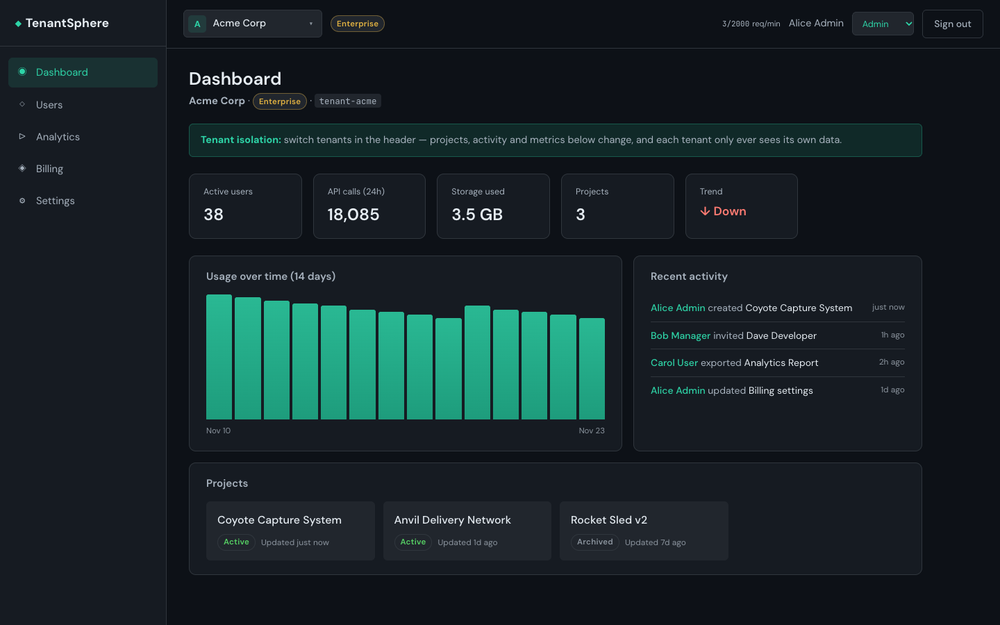
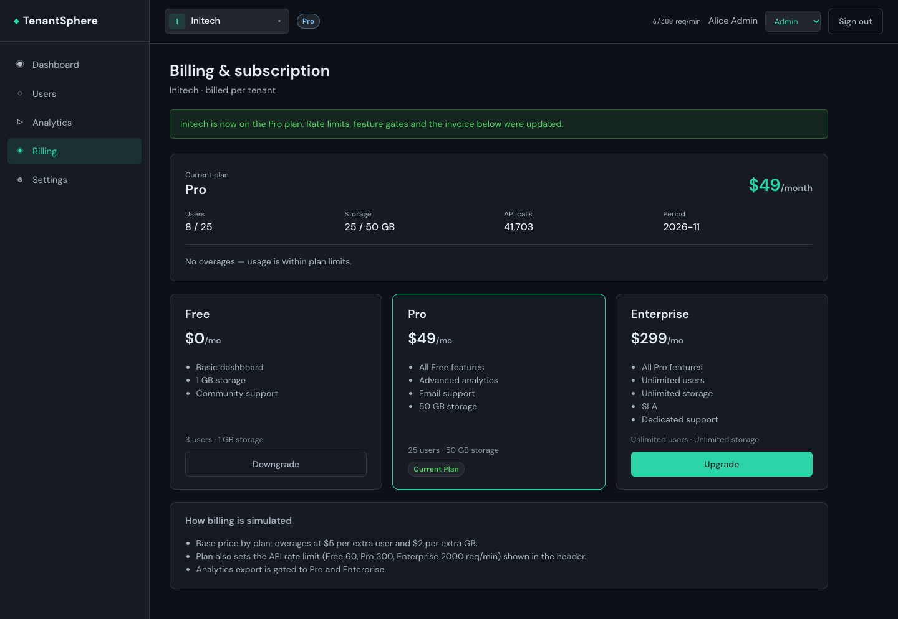
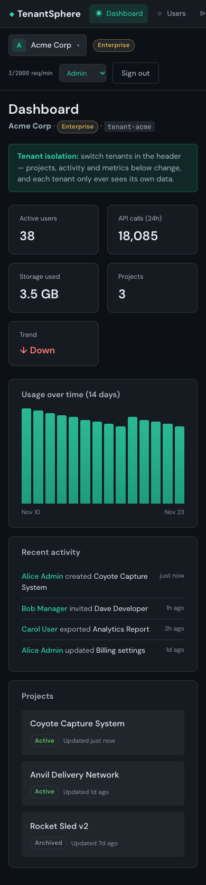
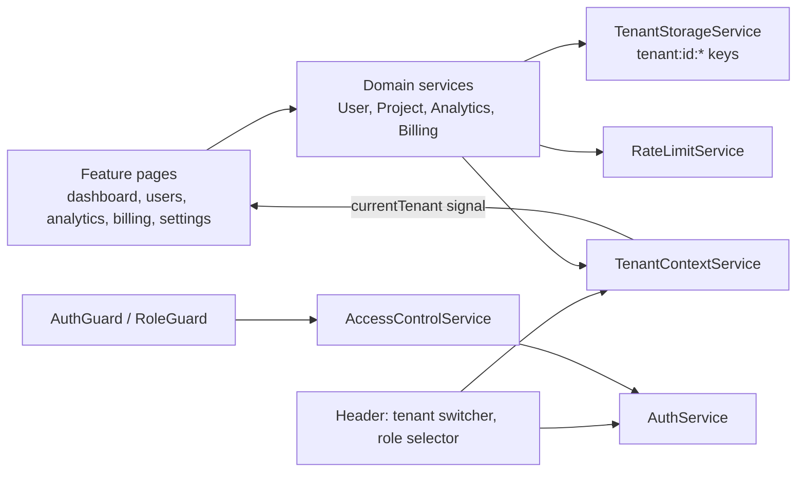

# TenantSphere

A front-end simulation of a multi-tenant SaaS platform: tenant isolation, role-based access control, subscription billing and plan-based rate limiting, all running locally with mock data.




| Billing (plan change) | Mobile |
| --- | --- |
|  |  |

## Features

- **Tenant isolation.** Seven seeded tenants, each with its own users, projects, activity and metrics. The header tenant switcher swaps the active tenant and every page reloads its tenant-scoped data. Edits are persisted under `tenant:{id}:*` keys in `localStorage`, so changes in one tenant never show up in another.
- **RBAC.** Admin, Manager and User roles map to a permission matrix. Route guards block pages, the sidebar hides links, and actions are gated per permission (for example, Managers can change user roles but not remove users). A "view as" role selector in the header lets you switch roles live; if the new role can't see the current page you are sent back to the dashboard.
- **Subscription billing.** Free, Pro and Enterprise plans with user and storage limits, overage charges ($5/user, $2/GB) and a monthly invoice per tenant. Admins can upgrade or downgrade, and the change takes effect immediately across the app.
- **Plan-driven behavior.** The plan sets the API rate limit shown in the header (60 / 300 / 2000 req/min, counted per tenant) and gates analytics CSV export to Pro and Enterprise.
- **Settings.** Admins can inspect the tenant's storage namespace and clear it without affecting other tenants.

## Try it

1. Sign in as **Acme Corp / Alice Admin** (Enterprise).
2. Switch to **Initech** in the header: projects, activity and metrics change, and the plan badge shows Free.
3. Open **Analytics**: export is locked on Free. Go to **Billing**, upgrade to Pro, and come back: export now works and the rate limit is 300 req/min.
4. In **Users**, edit a role or remove someone, then check **Settings** to see the tenant-scoped key that was written.
5. Switch the header role to **User**: Users and Settings disappear from the nav and billing becomes read-only.

## Tech stack

Angular 20 (standalone components, signals), TypeScript, RxJS, SCSS, Karma + Jasmine. No backend: services return mock data through RxJS observables with simulated latency, and state is persisted to `localStorage`.

## Architecture



- `TenantContextService` holds the active tenant as a signal. Feature pages subscribe to it with `toObservable(...)` + `switchMap`, so a tenant switch or plan change cancels in-flight requests and reloads that page's data.
- `TenantStorageService` prefixes every key with the tenant ID; `UserService` reads seed data until a tenant has saved its own copy.
- `AccessControlService` checks the current role against `ROLE_PERMISSIONS` in `core/models/permission.model.ts`.
- `BillingService` derives usage per tenant, computes the invoice and changes the tenant's plan.

This mirrors the "shared database with a `tenant_id` column" model at the application layer. A real system would enforce the same boundary server-side (row-level security or schema-per-tenant).

## Getting started

Requires Node.js 20.19+ (tested on Node 22 and 24).

```bash
git clone https://github.com/kashish14/SaaS-Multi-Tenancy-Simulation-Platform.git
cd SaaS-Multi-Tenancy-Simulation-Platform
npm ci
npm start
```

Open http://localhost:4200 and pick a tenant and user on the login screen.

## Scripts

| Command | Description |
| --- | --- |
| `npm start` | Dev server on port 4200 |
| `npm run build` | Production build to `dist/tenant-sphere` |
| `npm test` | Unit tests in watch mode (Chrome) |
| `npm run test:ci` | Single headless test run, as used in CI |

## Project structure

```
src/app/
├── core/          guards, models, services (tenant context, auth, RBAC, billing, rate limit)
├── platform/      shell, header, sidebar, tenant switcher
├── features/      login, dashboard, users, analytics, billing, settings
├── shared/        click-outside directive
└── data/          seeded tenants, users, projects, activity
```

## Testing

```bash
npm run test:ci
```

19 unit tests cover tenant-scoped storage keys and cross-tenant isolation, tenant switching, the role permission matrix and role switching, plan configs, feature gating, billing summaries and plan changes. GitHub Actions runs install, build and tests on Node 22 for every push and pull request.

## License

[MIT](LICENSE) © 2026 Kashish Agarwal
